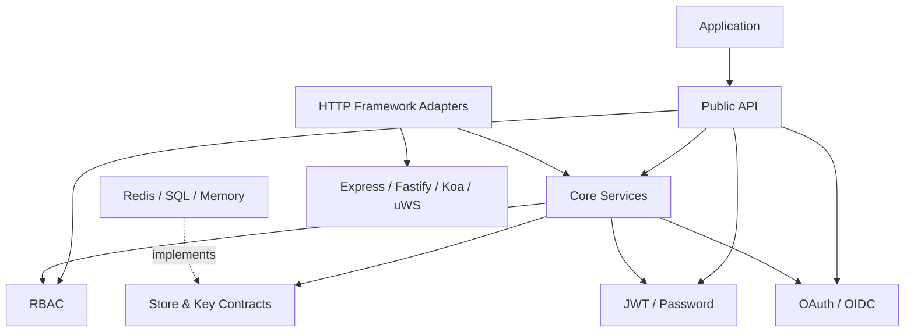

# `@oneunit/auth` Architecture

## 1. Purpose

`@oneunit/auth` is a framework-agnostic authentication and authorization package for Node.js applications. It provides:

- JWT signing and verification with pinned algorithms
- Access and refresh token lifecycle management (including rotation and reuse detection)
- Password hashing and verification (scrypt with bounded parameters)
- Role-based access control (RBAC) with inheritance and wildcard support
- OAuth 2.0 / OpenID Connect (OIDC) authorization-code flows with state + PKCE
- Session revocation and version-based invalidation
- Thin, security-conscious adapters for Express, Fastify, Koa, and uWebSockets.js

Security policy and domain behavior must remain independent of HTTP frameworks and persistence technologies.

## 2. Architectural goals

1. **Security by default** — Unsafe or incomplete configuration fails at construction time. Invalid or untrusted input never grants privileges.
2. **Explicit trust boundaries** — Request data, provider profiles, database records, and server-derived authorization data are never interchangeable.
3. **Infrastructure independence** — Redis, SQL, in-memory stores, and HTTP frameworks are adapters around core contracts.
4. **Composable installation** — Consumers import only the capabilities they need via subpath exports.
5. **Predictable contracts** — Public interfaces document atomicity, failure modes, and whether an operation is optional.
6. **Testability** — Core behavior is fully testable without a running web server or database.
7. **Compatibility discipline** — Public API and legacy aliases are versioned and covered by consumer-package tests.

## 3. Recommended module layout

```text
src/
  adapters/express/index.ts
  adapters/fastify/index.ts
  adapters/index.ts
  adapters/koa/index.ts
  adapters/uws/index.ts
  core/auth.ts
  crypto/jwt.ts
  crypto/password.ts
  errors/index.ts
  index.ts
  oauth/index.ts
  oauth/providers/index.ts
  rbac/index.ts
  stores/memory/index.ts
  stores/memory/refresh-store.ts
  stores/memory/session-store.ts
  stores/memory/state-store.ts
  types/index.ts
  utils.ts
```

Keep modules only when they improve ownership, testing, or dependency direction. Avoid one-file-per-function fragmentation.

## 4. Dependency direction



**Hard rules**

- `core/` never imports Express, Fastify, Koa, uWebSockets.js, Redis, or any concrete database client.
- Adapters only translate requests → core calls and map typed errors → HTTP responses.
- Store implementations depend on infrastructure and implement the package contracts.
- `crypto/` knows nothing about HTTP, users, or frameworks.
- OAuth providers normalize external data into a validated internal profile; they never assign roles.
- Only `index.ts` (and declared subpath exports) are public.

## 5. Main components and responsibilities

### `Auth` facade (`createAuth`)

Composition root only. Responsibilities:

- Validate every required option and dependency at construction time.
- Wire token, session, password, RBAC, and OAuth services.
- Expose a stable, ergonomic surface.
- Fail clearly when an optional feature is invoked without its required dependency.

Never put JWT policy, OAuth HTTP calls, password hashing, store operations, or RBAC algorithms inside the facade.

### Token service

- Pin accepted algorithms from configuration (never from the JWT header).
- Validate signature, `iss`, `aud`, `exp`, `nbf`, and token type (`typ`).
- Require `sub`, `jti`, and any other claims mandated by the token purpose.
- Reject refresh tokens presented to access-token verification paths.
- Validate custom claims against a reserved-claim allowlist.
- Decoding ≠ verification. Authorization decisions use only verified claims.

### Refresh & session services

- Every refresh token carries a unique `jti`.
- `consume(jti)` is atomic across all processes sharing the store.
- Failed consume → token is invalid / revoked / expired / already used → no new token pair is issued.
- Distinguish **rejected token** from **store outage**. Outages must not become silent authentication failures or successful logouts.
- `revokeAllSessions(userId)` succeeds only when the configured mechanism actually invalidates the relevant sessions.

### User store port

Application-owned. Required methods are capability-specific (e.g. password login needs `findByEmail` + `verify` path; `updatePassword` may be optional). Document exact requirements per capability. The package never assumes an ORM, schema, or uniqueness rule.

### RBAC service

- Roles and inheritance come only from trusted server-side configuration or explicit server options.
- Permission claims are derived from those definitions; they are never accepted from clients or providers.
- Explicit wildcard semantics + boundary tests.
- Missing subject → deny. A default role must never grant privileges to `null`/`undefined`.
- Cycle detection required.
- Empty permission requests → deny (documented safer default).
- Low-level matching is separate from the subject-presence check.

### Password service

- Self-describing format with validated cost parameters.
- Bound every parameter before calling scrypt; stored hashes are untrusted.
- Constant-time comparison for equal-length digests.
- Malformed stored hash → `false` without unbounded work.
- Validate input + config before expensive operations.
- Rehash after successful verification when policy and store support it.

Rate limiting, lockout, breached-password checks, and email verification remain application (or explicit extension) responsibilities.

### OAuth / OIDC service

- Cryptographically random, single-use state with TTL.
- PKCE required for public clients; policy explicit for confidential clients.
- State consumed atomically (`consume(state)`), never get-then-delete.
- Validate callback state before code exchange.
- Validate OIDC ID-token signature + claims (`iss`, `aud`, `exp`, `nonce` when applicable) with pinned algorithms.
- Require a stable provider subject identifier.
- Never use an unverified provider profile to assign application roles or permissions.
- Provider access/refresh tokens are separate credentials; they are never confused with package tokens.
- Normalized profile shape: `{ provider, subject, email?, emailVerified?, name? }`.
- Account linking and user provisioning are explicit application policies.

### Framework adapters

Thin translation layers only:

1. Extract credentials with explicit, configurable precedence (Bearer header default).
2. Call core verification / authorization.
3. Attach verified principal to the framework request/context.
4. Map known `AuthError`s to HTTP status codes.
5. Let unexpected errors fall through to the framework’s normal error handler.

**Non-negotiable security rules**

- Query-string token extraction is **disabled by default**.
- Cookie authentication must document CSRF protections and cookie attributes.
- Downstream application exceptions never become `401`.
- Never leak stacks, secrets, provider bodies, or raw tokens in responses or logs.
- For uWebSockets.js: snapshot request data before any asynchronous work; never retain request/response objects beyond their documented lifetime.

## 6. Store contracts (security contracts)

### Refresh store

```ts
interface RefreshStore {
  save(record: RefreshRecord): Promise<void>;
  get(id: string): Promise<RefreshRecord | null | undefined>;
  /** Atomically remove or mark consumed; returns the record at most once. */
  consume?(id: string): Promise<RefreshRecord | null | undefined>;
  revoke?(id: string): Promise<void>;
}
```

- `consume` is atomic across all processes using the store.
- Infrastructure errors reject/throw; they are never reported as `null`.
- Expired records are never accepted.
- In-memory `Map` is single-process only and must be documented as such.

### OAuth state store

Same atomic `consume(state)` contract. get-then-delete is insufficient under concurrency.

### Session version store

- Tokens carry the version observed at issuance.
- Verification compares token version with the authoritative store version.
- Revocation increments the version atomically.
- Store failure → fail closed when the policy promises online global revocation.
- Behavior for missing version records and legacy tokens without a version is documented.

## 7. Login and token issuance pipeline

1. Validate login input and required identity.
2. Resolve user through a trusted path.
3. Reject inactive / disabled / unverified users per policy.
4. Run security-critical pre-login hooks (throw → fail the operation).
5. Resolve roles from trusted server-side data only.
6. Derive permissions via RBAC.
7. Construct claims via allowlist; reject reserved-claim collisions.
8. Issue access token with required identity, type, expiry, `iss`/`aud`, and unique identifier.
9. If refresh is enabled: create refresh record, issue refresh token.
10. Persist refresh record **before** returning the pair.
11. Run audit hooks with documented failure semantics (awaited vs fire-and-forget).
12. Return only the intended result.

Public registration payloads, OAuth profiles, arbitrary `additionalClaims`, and user-controlled DB fields **must never** override identity, role, permission, issuer, audience, token type, expiry, or token identifier claims.

## 8. Token lifecycle and revocation guarantees

| Operation                        | Refresh token                                      | Existing access token                                      |
|----------------------------------|----------------------------------------------------|------------------------------------------------------------|
| Logout one session               | Revoke immediately via refresh store               | Valid until expiry unless verification checks revocation/session state |
| Rotate refresh token             | Atomic consume + new pair                          | Remains valid unless separately invalidated                |
| Role change                      | New tokens reflect updated trusted roles           | Existing claims remain until expiry unless live-checked    |
| Revoke all sessions (version)    | Reject refresh with stale version                  | Reject verification when versions differ                   |
| Store unavailable                | Fail the operation; never claim success            | Fail closed if policy promises online revocation           |

Document the actual guarantee. Stateless access tokens cannot be instantly revoked without an online check, denylist, short TTL, or equivalent.

## 9. Error model

Stable `AuthError` base with machine-readable `code`, safe public message, and optional internal cause.

Suggested codes:

- `INVALID_TOKEN`
- `TOKEN_EXPIRED`
- `UNAUTHORIZED`
- `FORBIDDEN`
- `VALIDATION_ERROR`
- `CONFIGURATION_ERROR`
- `OAUTH_ERROR`
- `PROVIDER_ERROR`

HTTP mapping lives in adapters (`401` for missing/invalid credential, `403` for authenticated-but-forbidden, `5xx` for dependency outages). Never automatically expose internal messages or stack traces to clients. Preserve the original cause for diagnostics without serializing secrets.

## 10. Public exports and package boundaries

`index.ts` is the stable surface. Prefer subpath exports:

```ts
// Main
export { createAuth } from "./core/auth.js";
export { createRBAC, RBAC } from "./rbac/index.js";
export { hashPassword, verifyPassword, needsRehash } from "./crypto/password.js";

// Optional feature entry points, grouped in src/index.ts
export { OAuth, createOAuth, createMemoryStateStore } from "./oauth/index.js";
export { expressAdapter, fastifyAdapter, koaAdapter, uwsAdapter, snapshotUwsRequest, createAdapters } from "./adapters/index.js";
export { createMemoryRefreshStore, createMemorySessionStore } from "./core/index.js";
```

Use `package.json` `exports` for public entry points. The package also exposes a generic `./*` mapping to built files, so documented entry points (especially `index.ts`) remain the supported public surface. Compatibility shims are documented and tested before removal.

## 11. Configuration design

Validate once at construction.

Must cover:

- Algorithm + key/secret configuration (no predictable fallbacks)
- Separate access/refresh keys or asymmetric strategy where appropriate
- Issuer, audience, TTLs, clock tolerance
- Required store methods
- RBAC definitions + safe default-role behavior
- OAuth providers, callback URLs, state-store policy, PKCE
- Password hashing policy + bounded costs
- Optional session-version checking
- Logging/audit hooks that cannot expose credentials

Production safeguards:

- Fail at startup on missing secrets or required store methods.
- Algorithm selection is pinned; never negotiated from untrusted headers.
- In-memory stores are visibly unsuitable for multi-instance production.
- TTL parsing is strict and validated at configuration time.

## 12. Testing strategy

### Unit

JWT claim construction, reserved claims, algorithm pinning, token-type separation, RBAC inheritance/cycles/wildcards/absent subjects, password parsing/bounds/rehash, OAuth state/PKCE/profile/OIDC claims, error codes.

### Contract (required for every store implementation)

- Concurrent atomic refresh-token consume
- Concurrent atomic OAuth state consume
- Expiry and missing-record behavior
- Revocation behavior
- Infrastructure errors ≠ invalid/missing records

### Adapter

Credential precedence, query-token disabled by default, optional auth, principal attachment, `401` vs `403`, downstream errors pass through, CSRF documentation, uWS snapshot before async work.

### Integration / release

End-to-end password + OAuth flows, refresh rotation + replay rejection across instances, session-version revocation, TypeScript consumer fixture, every documented import path after `npm pack`, package contents inspection.

Security regression tests are mandatory CI gates.

## 13. Observability

Optional structured events for login success/failure, refresh reuse, logout, global revocation, OAuth/provider errors.

- Never log passwords, raw tokens, authorization codes, client secrets, PKCE verifiers, or cookie values.
- Prefer stable event names and safe identifiers.
- Avoid logging full OAuth callback URLs.
- Low-cardinality metrics only; never use raw user IDs or tokens as labels.
- Compliance-critical audit delivery is an application-owned reliable mechanism, not a best-effort callback.

## 14. Recommended implementation order

1. Document and freeze security contracts (claims, stores, errors, trust boundaries).
2. Formalize store ports with atomic consume guarantees + contract tests.
3. Harden token/claim policy and reserved-claim rules.
4. Separate core services from the facade without behavior change.
5. Review OAuth/OIDC validation and account-linking boundaries.
6. Make adapter behavior consistent; preserve downstream error handling.
7. Add consumer-package and contract tests before public-export reorganization.
8. Add subpath exports + deprecation policy only after compatibility tests pass.
9. Update examples and docs to show safe configuration and production store requirements.
10. Full release gate: tests, typecheck, build, pack inspection, consumer fixture, security review.

Refactor incrementally. Directory moves alone do not improve security.

## 15. Non-goals (application responsibilities)

Unless explicitly added as separate capabilities, the application owns:

- Rate limiting and abuse detection
- Email verification and password-reset flows
- MFA / recovery policies
- Account lockout and suspicious-login policy
- User lifecycle, tenant membership, account linking
- CSRF policy for cookie-based authentication
- Authorization that depends on live resource ownership
- Secret distribution, key-rotation operations, durable audit delivery

## 16. Architecture acceptance criteria

The architecture is ready when:

- Core services import no HTTP framework or concrete persistence client.
- Adapters contain only translation logic.
- Refresh and OAuth state stores guarantee atomic one-time consumption under concurrency.
- Infrastructure failures cannot masquerade as successful revocation or authentication success.
- Missing subjects are denied by authorization entry points.
- Untrusted claims cannot override identity or authorization claims.
- JWT algorithms and OIDC validation rules are pinned and tested.
- Every supported public import path works from the packed package.
- Legacy aliases have explicit, tested compatibility behavior.
- Security invariants are enforced by automated tests and the documented guarantees match implementation behavior.
```