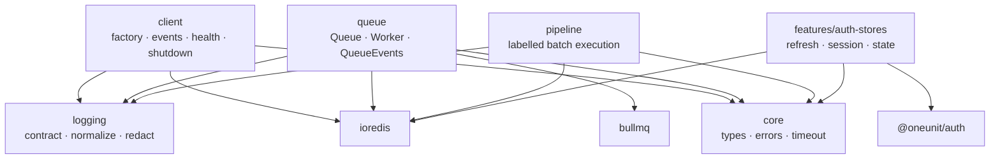
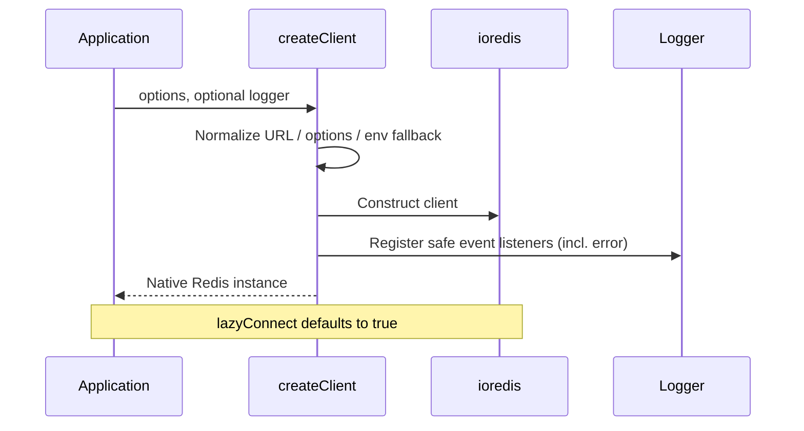
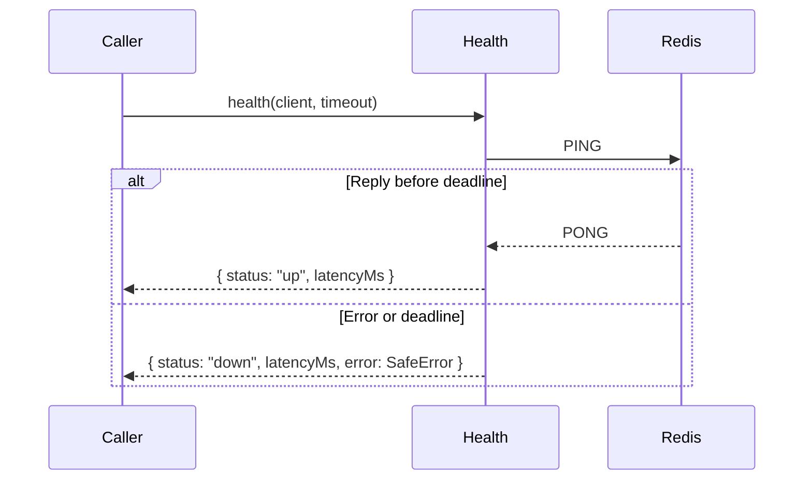

# Architecture — `@oneunit/redis`

**Status:** Target architecture  
**Audience:** Maintainers and contributors of `@oneunit/redis`  
**Guiding question:** What is the smallest set of guarantees that prevents recurring Redis/BullMQ integration failures without hiding the underlying libraries?

---

## 0. Executive summary

`@oneunit/redis` is a thin, opinionated integration layer over **ioredis** and **BullMQ**, with an optional adapter for **`@oneunit/auth`**.

It exists to:

1. Apply safe, repeatable defaults (connection options, redaction, timeouts).
2. Make resource ownership and shutdown contracts explicit.
3. Bound operations that commonly hang (health, pipeline, shutdown).
4. Keep subpath dependency surfaces small and independently loadable.
5. Verify that the *packed* package—not just the source tree—behaves as documented.

It does **not** exist to replace ioredis/BullMQ, introduce a connection pool, cache layer, repository pattern, or framework runtime.

**Non-negotiables**

| Guarantee | Why it matters |
|---|---|
| Native objects returned | Full library compatibility; no proxy surprises |
| Explicit ownership | No double-close, no orphaned reconnect loops |
| Bounded waits | Callers never hang indefinitely on health/pipeline/shutdown |
| Credential redaction | Secrets never reach logs or public error surfaces by default |
| Subpath isolation | Importing `client` must not load BullMQ |
| Artifact-tested public API | Type declarations, exports, and runtime match the published tarball |

---

## 1. Purpose and design principles

### Architectural principles

1. **Thin wrappers, explicit contracts.** Add behavior only where it prevents a recurring integration error or provides a clear, reusable guarantee.
2. **Dependency direction is one-way.** Shared primitives sit below clients, queues, pipelines, and optional features. Subpaths must not import unrelated subsystems.
3. **Ownership is explicit.** Every connection and event listener has a documented owner and a single shutdown path.
4. **Failures are bounded where promised.** Health, pipeline, and shutdown settle within documented deadlines. A deadline bounds the *caller’s wait*; it does not cancel the underlying Redis command unless explicitly documented otherwise.
5. **Security is centralized.** Redaction happens in one place before logging or returning errors through APIs that promise sanitization. Job payload logging is opt-in.
6. **Public behavior is tested from the packed artifact.** Type declarations, export maps, source maps, and runtime imports are part of the package contract.
7. **No hidden infrastructure.** No connection pool, cache, serializer, retry engine, or framework-specific dependency unless a concrete consumer requirement justifies it.

### Design tension to keep visible

| Choice | Benefit | Cost |
|---|---|---|
| Native ioredis / BullMQ objects | Zero abstraction tax | Consumers must understand library semantics |
| `lazyConnect: true` | No import-time side effects | Readiness is the caller’s responsibility |
| `maxRetriesPerRequest: null` | BullMQ-compatible | Commands can wait indefinitely without wrapper bounds |
| Promise-based deadlines | Prevent hung callers | Timeout ≠ cancellation |
| Separate subpaths | Smaller dependency surface | Export maps and consumer tests require ongoing care |

---

## 2. Scope and non-goals

### In scope

- Creating and configuring an ioredis client with safe defaults.
- Connection event logging with credential redaction.
- Bounded Redis health checks.
- Graceful, idempotent client shutdown with a forced-close deadline.
- BullMQ Queue, Worker, and QueueEvents factories with documented option merge rules.
- Labelled, bounded pipeline execution with explicit per-command results.
- Optional Redis-backed auth-store adapters for `@oneunit/auth`.
- Optional queue-backed delayed operations (for example scheduled session revocation) built on the queue and pipeline contracts, kept out of the base Redis client.
- Public package exports, subpath isolation, and release verification.

### Out of scope

- Implementing Redis commands or replacing ioredis.
- Implementing a queue engine or replacing BullMQ.
- Application-specific cache policies, key schemas, or domain repositories.
- Automatic distributed locks, rate limiting, or idempotency (unless introduced later as separately designed features).
- A mandatory logger, HTTP framework, metrics provider, or process manager.
- Automatic lifecycle management for resources the package did not create.
- Multi-tenant key isolation or encryption-at-rest.

---

## 3. Dependency graph and boundaries



### Boundary rules (must be enforced by tests)

| Rule | Rationale |
|---|---|
| `client/` never imports BullMQ | Keeps `@oneunit/redis/client` free of queue weight |
| `queue/` does not import client health/shutdown implementation | Avoids coupling; may share types and redaction only |
| `pipeline/` does not import the root barrel | Prevents accidental initialization and cycles |
| Base client/queue subpaths never import `@oneunit/auth` | Auth remains truly optional |
| Internal modules prefer direct file imports over broad barrels | Prevents cycles and accidental surface expansion |
| Root `index.ts` only re-exports | No business logic in the composition root |
| Every public subpath is independently loadable | No side effects from unrelated modules |

### Suggested dependency classification

| Package | Role | Notes |
|---|---|---|
| `ioredis` | dependency | Package constructs clients |
| `bullmq` | dependency | Package constructs queues/workers |
| `@oneunit/auth` | optional peer (or separate adapter package) | Must not be required by base install |
| Logger libraries | none | Accept any compatible shape; no hard dependency |

---

## 4. Source layout

```text
src/
├── index.ts                          # public composition only
├── core/
│   ├── types.ts
│   ├── errors.ts
│   └── timeout.ts                    # only if health/pipeline/shutdown share semantics
├── logging/
│   ├── index.ts
│   ├── types.ts
│   ├── normalize.ts
│   └── redact.ts
├── client/
│   ├── index.ts
│   ├── client.ts
│   ├── events.ts
│   ├── health.ts
│   └── shutdown.ts
├── queue/
│   ├── index.ts
│   ├── queue.ts
│   ├── worker.ts
│   ├── events.ts
│   └── lifecycle.ts
├── pipeline/
│   ├── index.ts
│   ├── builder.ts
│   └── types.ts
└── features/
    ├── index.ts
    └── auth-stores/
        ├── index.ts
        ├── refresh-store.ts
        ├── session-store.ts
        └── state-store.ts
```

This is a target structure. Move code only when separation improves cohesion or testability. Do not invent a generic `timeout` utility that obscures the distinct cancellation and settlement semantics of each operation.

---

## 5. Public entry points

| Entry point | Responsibility | May depend on |
|---|---|---|
| `@oneunit/redis` | Convenient root API | Client, queue, pipeline, logging; auth only if deliberately re-exported |
| `@oneunit/redis/client` | Client factory, events, health, shutdown | ioredis only |
| `@oneunit/redis/queue` | Queue, Worker, QueueEvents factories | bullmq + ioredis types |
| `@oneunit/redis/pipeline` | Labelled pipeline execution | ioredis |
| `@oneunit/redis/features` | Auth-store adapters | ioredis + `@oneunit/auth` |

### Export rules

- Every documented subpath has matching ESM runtime and TypeScript declaration targets.
- No wildcard exports that leak internal modules.
- Internal helpers (timeout, redaction, lifecycle bookkeeping) stay private unless a real consumer need is demonstrated.
- Optional auth must be reflected accurately in `package.json` (optional peer or separate package). Claiming “optional” while always installing it is a contract violation.
- Document and CI-test the minimum supported Node.js version.
- Prefer keeping `ioredis` and `bullmq` as direct dependencies while the package constructs their objects. Revisit only if supporting consumer-owned major versions becomes an explicit goal.

---

## 6. Redis client lifecycle

`createClient()` returns a **native ioredis instance**. It does not proxy, subclass, or restrict commands.

### Creation flow



### Defaults and configuration

| Setting | Default | Rationale |
|---|---|---|
| `lazyConnect` | `true` | Avoid import-time connection side effects |
| `maxRetriesPerRequest` | `null` | Required for BullMQ-compatible usage |
| URL resolution | Explicit URL > `REDIS_URL` > error/validate | Never silently fall back to localhost on misconfiguration |
| `keyPrefix` | Reject or strongly document incompatibility with BullMQ | Use BullMQ `prefix` instead |

Rules:

- Accept a URL string if it is part of the documented API; pass it via ioredis’s URL constructor signature.
- Validate malformed inputs early. A likely configuration mistake must not become an unintended localhost connection.
- Never log the full connection URL or credentials.
- Document that overriding `maxRetriesPerRequest` can make the client incompatible with BullMQ workers.

### Ownership matrix

| Factory | What is owned | Who closes it | What is *not* closed |
|---|---|---|---|
| `createClient()` | Returned ioredis client | Application via `shutdown(client)` or equivalent | — |
| `createQueue()` | Queue instance | Caller | Application’s original client |
| `createWorker()` | Worker + its blocking connection | Caller | Application’s original client |
| `attachQueueEvents()` | QueueEvents wrapper + its connection | Caller | Application’s original client |
| `shutdown(client)` | Only the supplied client | Package (idempotent) | Any BullMQ objects |

BullMQ may duplicate a supplied connection for blocking use. Closing a Worker or QueueEvents closes *its* owned connection, not the application client.

If a future managed-resource API is added, it must track only resources *it* creates and must never silently take ownership of caller-provided clients.

---

## 7. Logging and error redaction

One logger contract. One normalization layer. Logger injection is optional; the default is a silent no-op. A console adapter may be offered for convenience but must never be selected unexpectedly in production.

### Rules

1. Always register an ioredis `error` listener—even with no logger—to prevent process crashes from unhandled `error` events.
2. Normalize supported logger signatures in one place. Isolate pino (or similar) argument-order handling and cover it with tests.
3. Redact *before* any log or public error surface.
4. Preserve useful diagnostics: error class, safe message, operation name, connection state.
5. Strip: passwords, tokens, credential-bearing URLs, sensitive command arguments (e.g. `AUTH`, `HELLO`).
6. Do **not** log raw queue job data by default. If needed, require an explicit option with a documented warning and a redaction hook.
7. Test redaction on every path that can surface errors: events, rejected promises, queue events, pipeline, shutdown.

### Redaction test matrix (minimum)

| Input | Expected outcome |
|---|---|
| URL with password | Password removed / replaced |
| Nested `cause` with credentials | Cause sanitized |
| `AUTH` / `HELLO` command args | Args redacted |
| Job payload containing tokens | Not logged unless opt-in + redacted |

---

## 8. Health checks

`health(client, { timeout })` performs a bounded `PING` and returns a documented result: `up` + latency, or `down` + latency + safe error summary.



### Required behavior

- The returned promise **must settle** within the configured deadline, even while ioredis is reconnecting and queueing commands offline.
- Clear the timer on every settled path (success, error, timeout).
- Validate timeout values once: non-finite, zero, or negative → documented default **or** clear validation error. Choose one policy and test it consistently.
- **Do not claim cancellation.** A Promise race only bounds the caller’s wait. The PING may still complete or remain queued later. Document this distinction in the public API.
- Timer `ref`/`unref` behavior must be deliberate and tested. If the deadline must deliver a result while the process is otherwise idle, the timer must keep the event loop alive.
- Health checks must not mutate client configuration or disconnect a shared application client.

---

## 9. Graceful shutdown

`shutdown(client, { timeout })` is **idempotent** and **bounded**.

### Lifecycle

1. If the client is already ended or was previously force-closed by this package → return immediately (idempotent).
2. Attempt graceful `QUIT`; allow pending replies to complete.
3. If the graceful deadline expires → force disconnect to stop reconnect attempts.
4. Treat a connection that closes during shutdown as an expected terminal condition.
5. Log only sanitized diagnostics for unexpected failures.
6. Record forced closure in package-owned state (e.g. `WeakSet`), never by mutating the public Redis instance.

### Contract (recommended)

- **Resolve** when the connection is definitively closed (gracefully or forcibly).
- **Reject** only when the package cannot establish that teardown completed.
- A timeout bounds how long `shutdown()` waits; it does **not** prove every pending operation succeeded.

Document the chosen contract and test it. Do not register process signal handlers inside the library; applications own signal handling and shutdown ordering (workers → QueueEvents → queues → base client).

---

## 10. BullMQ queue subsystem

Factories construct **native BullMQ objects** and apply documented defaults without hiding BullMQ behavior.

### Factories

| Factory | Responsibility |
|---|---|
| `createQueue()` | Queue with documented prefix and job defaults |
| `createWorker()` | Worker; forward only defined options (concurrency only if supplied) |
| `attachQueueEvents()` | Managed event logging; returns a closable object |

### Option merge semantics

- Never pass absent options as explicit `undefined` if that overwrites a library default.
- Merge `defaultJobOptions` **per key** so overriding one option preserves unrelated defaults.
- Preserve intentional `null` values when the underlying library assigns meaning to them.
- Prefer a clearly specified shallow / per-key merge over silent deep-merge of arbitrary nested options.
- Derive QueueEvents prefix from the Queue’s effective options when no override is supplied.
- Validate only options the wrapper owns; leave the rest to BullMQ unless a concrete integration bug justifies extra validation.

### Connection and close behavior

- Workers and QueueEvents require blocking connections and may duplicate a supplied ioredis client. Document and test this.
- `close()` failure handling must prefer public error types over message matching.
- Any compatibility fallback for duplicate package copies belongs in one isolated helper, tested against supported BullMQ versions.
- Forced-close workarounds must be narrowly scoped, must not reach into undocumented internals without a compatibility test, and must not leave orphaned reconnect loops.

### Event payload safety

Default queue event logs to **metadata only**: queue name, job ID, event name, duration, sanitized failure reason.  
Raw job payloads are excluded by default (they may contain PII, credentials, or secrets). Opt-in logging must be explicit and redacted.

---

## 11. Pipeline subsystem

`runPipeline()` is a labelled orchestration helper over ioredis’s native pipeline. It is **not** a transaction and does **not** make a batch atomic.

### Contract

- Each step has a stable label and synchronously queues exactly one command.
- An asynchronous step is rejected **before** `EXEC`.
- A step that throws aborts batch construction; a partially constructed pipeline must never execute accidentally.
- Results are mapped to labels by position.
- Each step result distinguishes a successful `null` from a command error.
- Connection-level `exec()` rejection follows one documented contract and is sanitized where required.
- A configurable deadline bounds the caller’s wait; it does not cancel a command already sent to Redis.
- `throwOnError` behavior is explicit. A non-throwing mode returns per-command failures; a strict helper (e.g. `pipelineValues()`) can throw on any failure.
- Never return raw command errors if the API promises redaction.

### Suggested result shape

```ts
type SafeError = {
  name: string;
  message: string;
  // no credentials, no raw command args
};

type PipelineStepResult<T = unknown> = {
  label: string;
  value: T | null;
  error?: SafeError;
};

type PipelineResult = {
  results: PipelineStepResult[];
  durationMs: number;
  failed: boolean;
};
```

Preserve existing public types unless a change is required; any public type change needs a compatibility review.

### Implementation safeguards

Checking pipeline queue length before and after each step guards against multi-command or zero-command steps. This relies on ioredis internals that may be version-sensitive—pin the behavior with compatibility tests and isolate the check behind a small helper. Test both synchronous throws and async callbacks that return a promise.

---

## 12. Optional authentication stores

Auth-store adapters are **integration features**, not core Redis functionality.

- Keep refresh-token, session, and state stores in separate modules; share contracts only where implementations genuinely share behavior.
- Use `@oneunit/auth` interfaces as the source of truth; do not duplicate interface definitions.
- Document: key namespaces, TTL semantics, serialization format, and behavior when Redis is unavailable.
- Never log stored values, tokens, session contents, or raw keys if keys contain sensitive identifiers.
- Decide explicitly: fail closed, fail open, or propagate. Security-sensitive session/refresh operations must **not** silently succeed when persistence failed.
- Test: expiry, missing records, malformed values, concurrent updates, Redis outages.
- Delayed operations, when offered, must receive an explicit caller-owned queue/connection, never create hidden workers or bypass Redis TTL.
- Keep auth-store exports out of client and queue subpaths.

---

## 13. Error model

Prefer stable package error classes for errors the package itself creates:

| Error | When used |
|---|---|
| `HealthCheckTimeoutError` | Health deadline exceeded |
| `ShutdownTimeoutError` | Only if the chosen contract rejects on timeout |
| `PipelineTimeoutError` | Pipeline deadline exceeded |
| `PipelineStepError` | Step construction failed (async step, throw, multi-command) |
| `PipelineCommandError` / safe error shape | Per-command failure when needed by public API |

Rules:

- Do not automatically wrap every third-party error.
- Preserve the original cause internally where supported.
- Ensure public and logged representations never expose credentials.
- Document which functions throw, which return failure results, and which treat expected terminal conditions as success.

---

## 14. Testing strategy

Layered tests. CI must prove that integration tests actually ran.

### Unit tests

- URL normalization, env fallback, invalid inputs.
- Default options and caller override precedence.
- Omission of undefined options vs intentional `null`.
- Logger normalization for every supported shape.
- Credential redaction (URLs, AUTH/HELLO, nested causes).
- Timeout validation and deadline cleanup.
- Pipeline one-command-per-step validation.
- Idempotent shutdown and forced-close bookkeeping.

### Integration tests (real Redis required)

- Client connects and executes commands.
- Health returns `up`; returns `down` within deadline when Redis is unavailable.
- Queue creation, job defaults, retries, backoff, retention, worker concurrency.
- QueueEvents with custom prefixes.
- Worker and QueueEvents close their owned connections.
- Pipeline maps values, nulls, and command errors correctly.
- Auth stores enforce TTL and expected failure semantics.

### Package-consumer (tarball) tests

Install the generated tarball into a clean fixture and verify:

- Every documented subpath imports successfully.
- ESM runtime exports and TypeScript declarations resolve.
- `@oneunit/redis/client` does not load BullMQ.
- Base entry points do not require the optional auth integration.
- Source maps resolve to files included in the package.
- The installed package works without access to the repository’s `src/` or `node_modules`.

### CI rules

| Rule | Enforcement |
|---|---|
| Unit tests may run without Redis | Only when they truly need no Redis |
| Integration tests require a live Redis | Fail the job if Redis is unavailable; never silently skip the suite in CI |
| Local skip is allowed | Print an explicit skip summary; must not be the release gate |
| Full gate | build → typecheck → unit → integration → pack → tarball smoke |
| No concurrent `dist/` mutation | Avoid deleting/rebuilding while workers import it |
| Regression tests must fail when the bug is reintroduced | Especially timeouts, redaction, lifecycle |

---

## 15. Packaging and release

- Clean `dist/` and incremental compiler metadata before every release build.
- Include source files if source maps point to them; otherwise configure maps so they resolve without shipping unnecessary files.
- Validate `exports`, `files`, `types`, `main`, and `module` against the actual emitted files.
- Test the packed tarball, not only `npm pack --dry-run`.
- Avoid running `prepack` in a test that is meant to inspect an already-built artifact if that script rewrites `dist/`.
- Pre-publish checklist: license, README, changelog, engines, dependency versions, tarball contents, clean-consumer install.
- Publish only after the full CI release gate passes with evidence, not after a green local run alone.

---

## 16. Observability

Provide useful hooks without forcing an observability stack.

- Logger injection remains optional.
- Lifecycle or metrics callbacks are acceptable only when real consumers need them.
- No mandatory metrics dependency.
- Never use high-cardinality labels (raw keys, user IDs, job payloads, full URLs) in metrics.
- Document which events are emitted and whether handlers can affect application behavior.

---

## 17. Compatibility and versioning policy

| Concern | Policy |
|---|---|
| Supported Node.js | Document minimum; CI tests the minimum |
| ioredis / BullMQ | Pin tested major ranges; compatibility tests on supported versions |
| Public API breakage | Semver major; changelog entry required |
| Subpath addition | Minor (additive) |
| Subpath removal or behavior change | Major |
| Optional auth dependency | Must remain optional across minor versions |
| Timeout / ownership contract changes | Major (these are behavioral contracts) |

---

## 18. Risks and trade-offs

| Decision | Benefit | Cost / caveat |
|---|---|---|
| Native ioredis / BullMQ objects | Low abstraction, full compatibility | Consumers must understand library semantics |
| `lazyConnect: true` | No construction-time side effect | Startup readiness is explicit |
| `maxRetriesPerRequest: null` | BullMQ worker compatible | Unbounded waits without wrapper deadlines |
| Bounded health / pipeline / shutdown | Avoids hung callers | Timeout does not cancel the Redis operation |
| Separate subpath exports | Smaller dependency surface | Export maps and consumer tests need maintenance |
| Optional auth adapter | Core stays reusable | Metadata and install behavior must match the claim |
| Job payload logging off by default | Reduces accidental data exposure | Debugging requires explicit, controlled opt-in |

---

## 19. Recommended implementation order

### Phase 1 — Lock down existing contracts

| Step | Acceptance criterion |
|---|---|
| Tests for exports, option merging, redaction, timeouts, shutdown, QueueEvents prefixes | Fail when the contract is violated |
| Document ownership and exact resolve/reject behavior of every lifecycle method | Docs match tests |
| Verify dependency metadata vs actual imports and optional feature behavior | `client` install does not pull auth; auth is optional |
| CI fails if required Redis integration tests do not run | Integration job cannot be green without Redis |

### Phase 2 — Extract shared primitives only where justified

| Step | Acceptance criterion |
|---|---|
| Centralize safe error formatting / redaction | Single implementation; all paths covered |
| Centralize logger normalization | One module; all supported shapes tested |
| Introduce timeout helper only if semantics are shared | No generic utility that obscures per-operation behavior |
| Keep internal helpers private | No accidental public export |

### Phase 3 — Harden BullMQ lifecycle

| Step | Acceptance criterion |
|---|---|
| Test ownership of Worker and QueueEvents blocking connections | Closing them does not close the app client |
| Validate close behavior on every supported BullMQ version | Compatibility suite green |
| Remove broad / undocumented internal workarounds where a public API exists | Prefer public APIs |
| Default queue event logs to metadata-only | No raw payloads without opt-in |

### Phase 4 — Verify release artifact

| Step | Acceptance criterion |
|---|---|
| Clean-tree build | No stale `dist/` |
| Typecheck + all unit/integration tests | Green |
| Pack + install tarball into clean consumer fixture | All subpaths work |
| Subpath isolation, declarations, source maps verified | Documented surface matches reality |
| Publish only after full release gate | Evidence from CI, not local only |

---

## 20. Definition of done

The architecture is ready when **all** of the following are true:

- [ ] Each subpath has a documented and tested dependency boundary.
- [ ] Resource ownership and shutdown ordering are unambiguous and tested.
- [ ] Every promised bounded operation settles within its deadline under success, failure, and Redis-unavailable conditions.
- [ ] Timeout behavior is never described as cancellation.
- [ ] Credentials and sensitive job data are not logged by default; redaction is tested on all exposure paths.
- [ ] Queue option merging preserves defaults and intentional overrides (including `null`).
- [ ] Pipeline results cannot become misaligned with labels; one-command-per-step is enforced.
- [ ] Redis integration tests are mandatory in CI and fail the job when Redis is missing.
- [ ] The packed package works in a clean consumer project for every documented entry point.
- [ ] Public API changes are intentional, versioned, documented, and covered by compatibility tests.
- [ ] Optional auth remains optional in both metadata and install behavior.

---

## Final recommendation

Keep `@oneunit/redis` a **thin integration package**.

Prioritize, in order:

1. **Lifecycle correctness** (ownership, idempotent shutdown, no orphaned connections)
2. **Security-safe observability** (central redaction, no payload logging by default)
3. **Precise failure contracts** (bounded waits, honest timeout semantics)
4. **Subpath isolation** (client without BullMQ; auth truly optional)
5. **Release verification** (tarball-tested, CI-enforced integration tests)

Do **not** add a connection pool, custom retry engine, cache, generic repository layer, or broad abstraction framework without a demonstrated consumer requirement and an explicit architecture revision.
## 21. Optional core helper primitives

The package may also ship dependency-free helper primitives as **optional features**:

- Key/namespace builders that validate and join key segments.
- JSON string codec helpers.
- TTL jitter helpers.
- Compare-and-swap and conditional write helpers.
- Capability probing through standard Redis commands.

These remain thin wrappers. They must not introduce a cache, repository, serializer framework, rate limiter, lock, or required process/runtime manager. Helpers with network behavior must be explicit and bounded where the contract promises it.
