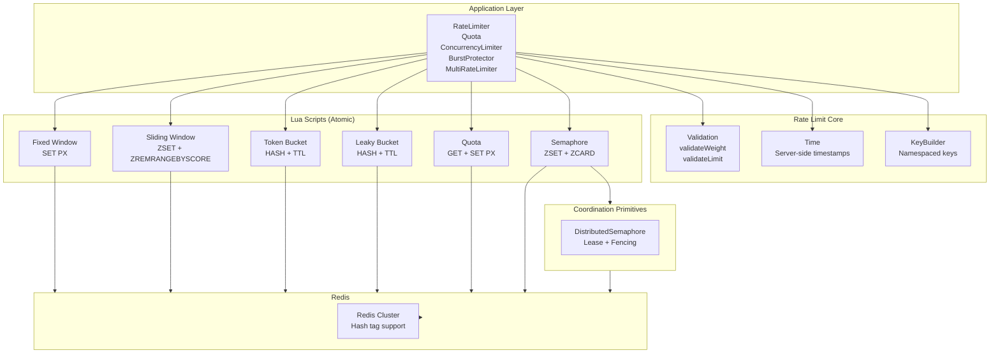

# Rate Limiting Architecture

This document describes the internal architecture, design decisions, and implementation details of the `@oneunit/redis/rate-limit` module.

## Overview

The rate limiting module provides distributed traffic control using Redis as the coordination backend. All state lives in Redis, enabling seamless operation across multiple application instances.



---

## Design Principles

### 1. Atomic by Default

Every rate limiting operation executes in a **single Lua script**. This eliminates read-modify-write races that would occur with separate Redis commands.

```lua
-- Example: Fixed window consume (atomic)
local current = tonumber(redis.call('GET', key) or '0')
local allowed = (current + cost) <= limit
if allowed then
  redis.call('SET', key, current + cost, 'PX', ttl)
end
return {allowed, new_count, reset_time}
```

**Why Lua?**
- Server-side execution guarantees atomicity
- Single round-trip per operation
- Server-side timestamps (`redis.call('TIME')`) eliminate clock skew

### 2. Distributed State

All counters, permits, and quotas live in Redis keys:
- No in-process state (except local-only utilities)
- Multiple application instances share the same limits automatically
- Horizontal scaling without sticky sessions

### 3. Observable Decisions

Every call returns rich metadata:
```typescript
interface RateLimitDecision {
  allowed: boolean;
  algorithm: string;
  limit: number;
  remaining: number;
  consumed: number;
  retryAfterMs: number | null;
  resetAt: number | null;
  resetAfterMs: number | null;
  reason: string | null;
  fallback: boolean;
  metadata?: Record<string, unknown>;
}
```

### 4. Explicit Failure Policy

```typescript
type FailurePolicy = "fail-open" | "fail-closed"; // Default: fail-closed
```

| Policy | Redis Down | Use Case |
|--------|------------|----------|
| `fail-closed` | Throw `RateLimitError` | Payments, auth, critical paths |
| `fail-open` | Allow with `fallback: true` | Analytics, logging, non-critical |

---

## Core Algorithms

### Fixed Window

**Key Pattern:** `ratelimit:{prefix}:fixed-window:{resource}`

**Data Structure:** Single Redis `STRING` with counter value.

**TTL:** `intervalMs` (window duration)

**Lua Logic:**
```
1. GET current count (default 0)
2. If current + cost <= limit:
     INCRBY cost
     If first request: SET PX intervalMs
3. Return allowed, remaining, resetAt
```

**Boundary Behavior:** Allows 2× burst at window boundaries (last moment of window N + first moment of window N+1).

---

### Sliding Window

**Key Pattern:** `ratelimit:{prefix}:sliding-window:{resource}`

**Data Structure:** Redis `ZSET` (sorted set)
- **Member:** `${timestamp}:${uniqueToken}:${cost}`
- **Score:** `timestamp` (milliseconds since epoch)

**TTL:** `intervalMs + 1000ms` (buffer for cleanup)

**Lua Logic:**
```
1. ZREMRANGEBYSCORE key -inf (now - intervalMs)  -- Prune expired
2. ZRANGE key 0 -1 WITHSCORES                   -- Sum costs
4. If total + cost <= limit:
     ZADD key now:uuid:cost now
     PEXPIRE key (intervalMs + 1000)
5. Return allowed, remaining, retryAfterMs (based on oldest entry)
```

**Memory:** O(requests in window). Pruned on every request.

---

### Token Bucket

**Key Pattern:** `ratelimit:{prefix}:token-bucket:{resource}`

**Data Structure:** Redis `HASH`
- `tokens`: Current token count (float)
- `last`: Last refill timestamp (milliseconds)
- `capacity`: Stored for reference

**TTL:** 24 hours (86,400 seconds)

**Lua Logic:**
```
1. HGET tokens, last
2. elapsed = now - last (clamped to >= 0)
3. refill = elapsed * refillRatePerMs
4. newTokens = min(capacity, tokens + refill)
5. If newTokens >= cost:
     newTokens = newTokens - cost
     allowed = true
   Else:
     allowed = false
     retryAfter = ceil((cost - newTokens) / refillRatePerMs)
6. HSET tokens newTokens, last now, capacity
7. EXPIRE 86400
```

**Refill:** Approximate (at request time), not continuous.

---

### Leaky Bucket (Policing)

**Key Pattern:** `ratelimit:{prefix}:leaky-bucket:{resource}`

**Data Structure:** Redis `HASH`
- `water`: Current water level (float)
- `last`: Last leak timestamp (milliseconds)
- `capacity`: Stored for reference

**TTL:** 24 hours (86,400 seconds)

**Lua Logic:**
```
1. HGET water, last
2. elapsed = now - last (clamped to >= 0)
3. leaked = elapsed * leakRatePerMs
4. newWater = max(0, water - leaked)
5. If newWater + cost <= capacity:
     newWater = newWater + cost
     allowed = true
   Else:
     allowed = false
     retryAfter = ceil((newWater + cost - capacity) / leakRatePerMs)
6. HSET water newWater, last now, capacity
7. EXPIRE 86400
```

**⚠️ Policing, Not Shaping:** Denied requests return immediately with `retryAfterMs`. No queueing or delaying.

---

### Quota (Calendar-Based)

**Key Pattern:** `ratelimit:{prefix}:quota:{resource}`

**Data Structure:** Redis `STRING` (integer counter)

**TTL:** Period duration (daily = 86,400,000ms, monthly = ~2.6M ms)

**Lua Logic:**
```
1. GET current (default 0)
2. If current + (amount * weight) <= quota:
     INCRBY (amount * weight)
     If first: SET PX periodMs
     allowed = true
   Else:
     allowed = false
     retryAfter = resetAt - now
3. Return allowed, used, remaining, resetAt
```

**Reset Calculation (JS):**
```typescript
// Daily: next midnight UTC
const dailyReset = new Date(Date.UTC(y, m, d + 1, 0, 0, 0, 0));

// Monthly: 1st of next month UTC
const monthlyReset = new Date(Date.UTC(y, m + 1, 1, 0, 0, 0, 0));
```

---

## Distributed Concurrency (Semaphore)

**Key Pattern:**
- `ratelimit:{prefix}:{resource}:semaphore` (ZSET: token → expiry)
- `ratelimit:{prefix}:{resource}:semaphore:fencing` (STRING: counter)

**Both keys use hash tag `{resource}` for Redis Cluster.**

### Acquire Logic

```
1. ZREMRANGEBYSCORE semaphore -inf now     -- Clean expired
2. ZCARD semaphore                         -- Count active
3. If count < maxConcurrency:
     token = uuid()
     expiry = now + leaseMs
     ZADD semaphore token expiry
     fencing = INCR semaphore:fencing
     Return {acquired: true, token, fencing}
   Else:
     Return {acquired: false, error: "exhausted"}
```

### Release Logic

```
1. ZREM semaphore token
2. Return {released: true/false}
```

### Lease Expiration

- TTL on semaphore key = `leaseMs + 1000ms`
- Expired entries cleaned on every acquire
- Automatic reclamation when client dies

### Fencing Tokens

- Incrementing counter per successful acquire
- Stored in separate key with same hash tag
- Enables mutual exclusion with fencing

---

## Weighted Requests

All algorithms support `cost` parameter (default: 1).

**Validation (JS, before Lua):**
```typescript
function validateWeight(weight: number): void {
  if (!Number.isFinite(weight) || weight <= 0) {
    throw new RateLimitConfigError("weight must be a positive finite number");
  }
}
```

**Lua:** Cost used directly in arithmetic (no additional validation needed).

**Supported:**
- Integer costs: 1, 5, 10
- Fractional costs: 1.5, 0.1
- Large costs: validated against capacity/limit

---

## Multi-Dimensional Limiting

`MultiRateLimiter` composes multiple independent limiters.

**Evaluation Strategy:**
```typescript
async check(resource, cost) {
  const decisions = await Promise.all(limiters.map(l => l.check(resource, cost)));
  return { allowed: decisions.every(d => d.allowed), decisions };
}

async consume(resource, cost) {
  const check = await this.check(resource, cost);
  if (!check.allowed) return check;
  // Race window here - not atomic across limiters
  await Promise.all(limiters.map(l => l.consume(resource, cost)));
  return check;
}
```

**⚠️ Known Limitation:** Check-then-consume not atomic across limiters. If limiter A passes check but limiter B exhausts between check and consume, A will have consumed.

---

## Burst Protection

Combines three layers in sequence:

```typescript
async consume(resource, cost, acquireConcurrency) {
  // 1. Check all layers
  const sustained = await sustained.check(resource, cost);
  const burst = await burst.check(resource, cost);
  const concurrency = concurrency ? await concurrency.tryAcquire() : { acquired: true };

  // 2. Determine result
  const allowed = sustained.allowed && burst.allowed && concurrency.acquired;
  const reason = !sustained.allowed ? "sustained_limit"
               : !burst.allowed ? "burst_limit"
               : !concurrency.acquired ? "concurrency_limit" : null;

  // 3. If allowed, commit consumption
  if (allowed) {
    await sustained.consume(resource, cost);
    await burst.consume(resource, cost);
    // Use already-acquired concurrency permit
  } else if (concurrency.token) {
    await concurrency.release(concurrency.token); // Cleanup
  }
}
```

---

## Key Management

### Namespace Structure

```
ratelimit:{prefix}:{algorithm}:{resource}
ratelimit:{prefix}:{resource}:semaphore
ratelimit:{prefix}:{resource}:semaphore:fencing
ratelimit:{prefix}:quota:{resource}
```

### Hash Tags for Redis Cluster

```typescript
// Semaphore keys use hash tag
`ratelimit:{my-resource}:semaphore`
`ratelimit:{my-resource}:semaphore:fencing`

// Rate limiters: single key per resource (no CROSSSLOT risk)
// Multi-limiter: multiple keys - ensure same hash tag if needed
```

### TTL Strategy

| Component | TTL | Rationale |
|-----------|-----|-----------|
| Fixed Window | `intervalMs` | Auto-expires at window end |
| Sliding Window | `intervalMs + 1s` | Buffer for cleanup |
| Token/Leaky Bucket | 24 hours | Long-lived, refilled continuously |
| Quota | Period duration | Auto-expires at period boundary |
| Semaphore | `leaseMs + 1s` | Buffer for clock skew |

---

## Time Handling

### Server-Side Timestamps

All Lua scripts use `redis.call('TIME')`:
```lua
local time = redis.call('TIME')
local now = time[1] * 1000 + math.floor(time[2] / 1000)  -- Milliseconds
```

**Benefits:**
- No client clock dependency
- Consistent across all instances
- Resistant to NTP adjustments

### Elapsed Time Calculation

```lua
local elapsed = now - last
if elapsed < 0 then elapsed = 0 end  -- Handle clock drift
```

---

## Failure Handling

### Fail-Closed (Default)

```typescript
try {
  return await luaScript(...);
} catch (e) {
  throw new RateLimitError("Rate limit check failed", { cause: e });
}
```

### Fail-Open

```typescript
try {
  return await luaScript(...);
} catch (e) {
  return {
    allowed: true,
    fallback: true,
    metadata: { error: e.message },
    // ... other fields with safe defaults
  };
}
```

**⚠️ Known Issue:** Catches ALL errors including programming bugs. Should only catch operational Redis errors (ECONNREFUSED, ETIMEDOUT, etc.).

---

## Local-Only Utilities

These run in-process without Redis coordination:

### Adaptive Throttling
- Adjusts limit based on load signal (0-1)
- Hysteresis, min/max bounds, max adjustment rate
- **Each instance independent** - no shared state

### Load Shedding
- Admits/sheds based on in-flight count + priority
- Local counter only
- `queueThreshold` option accepted but unused

### Backpressure
- Admission control with optional waiting
- Busy-wait loop (no exponential backoff)
- No cancellation support
- Local counter only

---

## Testing Architecture

### Unit Tests
- Validation functions
- Metadata shape verification
- Configuration merge logic

### Integration Tests (Real Redis)
- Atomicity under concurrency (1000 parallel)
- Boundary conditions (exact limit, over limit)
- Window rollover / event expiration
- Lease expiration / reclamation
- Fail-open / fail-closed behavior

### Stress Tests
- Sustained load (50+ batches)
- Mixed check/consume
- Weighted requests

### Cluster Safety
- Hash tag verification
- CROSSSLOT risk assessment

### Lifecycle
- Idempotent shutdown
- No cross-test state leakage
- No unhandled rejections

---

## Extension Points

### Adding New Algorithm

1. Create Lua script in `scripts.ts`
2. Add algorithm type to `RateLimitAlgorithm`
3. Implement in `limiter.ts` with proper decision mapping
4. Add validation in `validation.ts`
5. Create comprehensive test file

### Adding New Feature

1. Follow subpath isolation rules
2. Use `coordination/` for shared primitives
3. Document failure policy
4. Add to `index.ts` exports
5. Create example in `EXAMPLES.md`

---

## Security Considerations

1. **No raw keys in logs** - Use key prefixes, not full keys
2. **Credential redaction** - Errors pass through `redactError`
3. **Input validation** - All costs validated before Lua
4. **No eval/scripts from user** - Only internal Lua scripts
5. **Fail-open caution** - Document that it catches all errors

---

## Performance Characteristics

| Algorithm | Redis Ops | Memory/Key | Typical Latency |
|-----------|-----------|------------|-----------------|
| Fixed Window | 1 (SET PX) | ~50 bytes | 0.3-0.8ms |
| Sliding Window | 3 (ZREM+ZRANGE+ZADD) | O(requests) | 0.8-2ms |
| Token Bucket | 3 (HGET+HSET+EXPIRE) | ~100 bytes | 0.3-0.8ms |
| Leaky Bucket | 3 (HGET+HSET+EXPIRE) | ~100 bytes | 0.3-0.8ms |
| Quota | 2 (GET+SET PX) | ~50 bytes | 0.3-0.8ms |
| Semaphore | 4 (ZREM+ZCARD+ZADD+INCR) | O(permits) | 0.5-1.5ms |

---

## Future Considerations

1. **Redis Cluster support** - Verify multi-key operations with hash tags
2. **Fail-open narrowing** - Only catch operational Redis errors
3. **Sliding window memory** - Add max entries or background compaction
4. **Multi-limiter atomicity** - Lua script for cross-limiter consume
5. **Distributed adaptive throttling** - Redis-backed coordination
6. **Cancellation support** - AbortSignal for backpressure/concurrency
7. **Priority queues** - For concurrency and backpressure